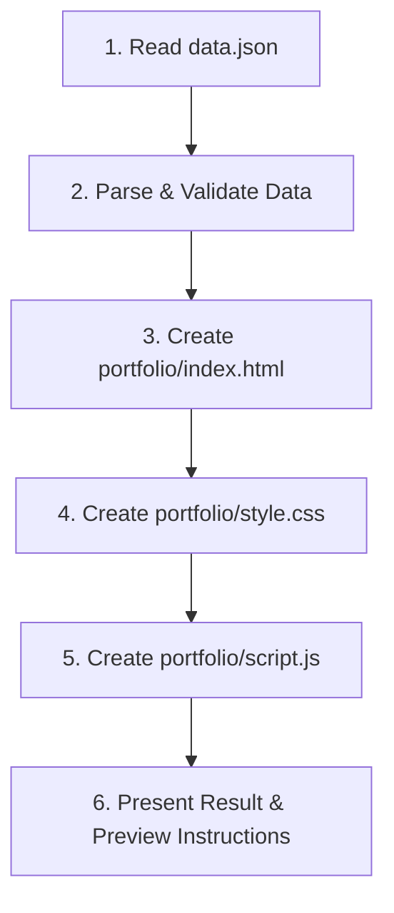

# Build Portfolio Skill (`build-portfolio`)

This skill instructs the agent to read the collected user data from `data.json` and autonomously generate a complete, premium, responsive personal portfolio website in the `portfolio/` folder without requiring external templates or build scripts.

---

## 1. Workflow Overview



---

## 2. Step-by-Step Instructions

### Step 1: Read and Parse `data.json`
- Read `data.json` at the workspace root.
- Extract:
  - `personal`: `fullName`, `title`, `location`, `avatar`, `bio`
  - `skills`: list of skills (`name`, `level`, `description`)
  - `contacts`: `telegram`, `github`, `email`, `linkedin`, etc.

### Step 2: Generate `portfolio/index.html`
Create `portfolio/index.html` using clean, semantic, SEO-friendly HTML5:
- **Semantic Structure:** `<header>`, `<nav>`, `<main>`, `<section>`, `<footer>`.
- **Core Sections:**
  1. **Navbar:** Brand badge with user's initials, anchor links (`#about`, `#skills`, `#contacts`), quick CTA button.
  2. **Hero:** If `avatar` is provided, render an avatar wrapper with glowing halo; if `avatar` is empty or skipped, omit the image completely so the Hero cleanly starts with the Location chip, Full Name, and Title.
  3. **About Section:** Rich presentation of user's bio in a frosted glass card.
  4. **Skills Grid:** Interactive cards for each skill featuring name, proficiency tag, and application description.
  5. **Contacts Grid:** Interactive cards for Telegram, GitHub, Email, LinkedIn with inline SVG icons.
  6. **Footer:** Dynamic copyright year and agent attribution tag.
- **Typography:** Modern Google Fonts (`Plus Jakarta Sans` or `Inter`).
- **Icons:** Clean, accessible inline SVGs (no external icon dependencies required).

### Step 3: Generate `portfolio/style.css`
Design `portfolio/style.css` with state-of-the-art aesthetics:
- **Color Palette:**
  - Deep dark background: `#0a0d14`, `#0f172a`
  - Accent gradients: Neon Cyan (`#06b6d4`), Indigo (`#6366f1`), Violet (`#8b5cf6`)
  - Contrast text: `#f8fafc`, muted text: `#94a3b8`
- **Visual Effects:**
  - Glassmorphism: `backdrop-filter: blur(14px)`, `background: rgba(17, 24, 39, 0.7)`, subtle border `rgba(255, 255, 255, 0.08)`
  - Ambient radial glow background highlights
  - Card hover transforms: `translateY(-4px)` with neon glow drop shadow
- **Responsiveness:** Fluid grid/flexbox architecture ensuring seamless layout on mobile phones, tablets, and desktops.

### Step 4: Generate `portfolio/script.js`
Add lightweight, native JavaScript interactivity in `portfolio/script.js`:
- Scroll spy: Highlight active navigation link as the user scrolls.
- Clipboard copy: 1-click email/handle copy with smooth toast notification feedback.
- Dynamic footer year update.

---

## 3. Delivery & Local Preview

Once all files are generated inside `portfolio/`:
1. Inform the user that their portfolio website has been generated.
2. Provide commands to preview it locally, for example:
   ```bash
   python3 -m http.server 8000 --directory portfolio
   ```
   and navigating to `http://localhost:8000`.
